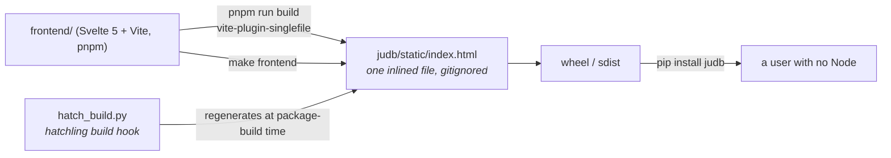
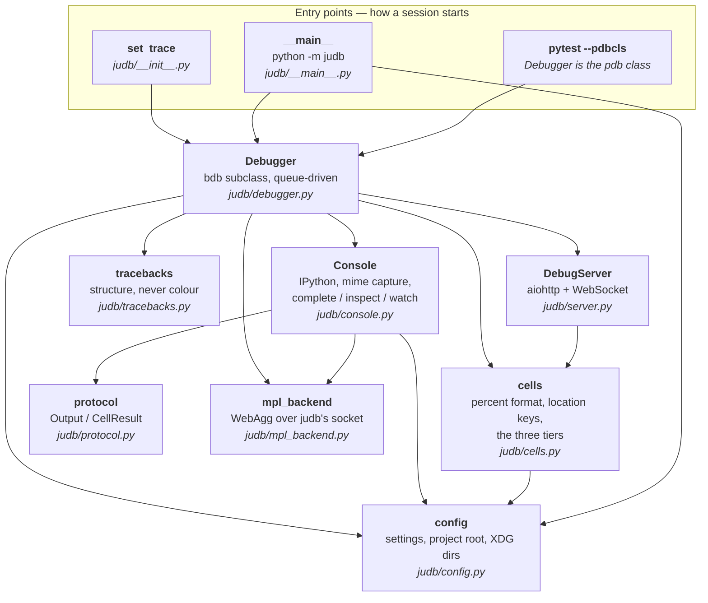
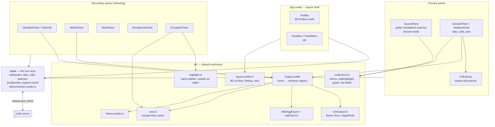

# judb — architecture

A [C4](https://c4model.com/) tour of the whole system: context, containers,
components, and the interfaces that hold them together. Companion to
`IMPLEMENTATION_PLAN.md` (the *why* and the roadmap) and the phase docs; this
file is the *what and where* — the map you want open when reading the code.

**How to read this.** Four levels, each zooming in one step:

| Level | Question it answers | Section |
| --- | --- | --- |
| 1 Context | Who uses judb, and what does it talk to? | [§1](#1-context) |
| 2 Container | What runs where — processes, threads, files? | [§2](#2-containers) |
| 3 Component | What is inside each container? | [§3](#3-components--the-debuggee-process), [§4](#4-components--the-browser-spa) |
| 4 Code | What are the actual interfaces? | [§5](#5-interfaces-the-level-4-detail) |

Pointers are `module` → `Symbol`, not line numbers: symbols survive edits and
are greppable, line numbers rot within a week. Every symbol named here exists;
`grep -n "def <name>" judb/*.py` finds it.

---

## 1. Context

judb replaces the terminal in a scientific Python debugging session. The user
keeps their normal program, their normal editor and their normal libraries; what
changes is that the "debugger prompt" becomes a browser page that can draw.

```mermaid
flowchart TB
    user(["Scientist / RSE<br/><i>debugging a Python module</i>"])

    subgraph judbsys ["judb"]
        judb["<b>judb</b><br/>browser-based visual debugger<br/><i>runs inside the debuggee process</i>"]
    end

    prog["<b>The program under debug</b><br/>a script, a module, or a pytest run<br/><i>Python 3.13+</i>"]
    browser["<b>Web browser</b><br/>localhost only, token in the URL"]
    ipython["<b>IPython</b><br/>InteractiveShell, completer,<br/>display formatter"]
    mpl["<b>matplotlib</b><br/>inline backend + WebAgg core"]
    files["<b>Files on disk</b><br/>saved cells, config<br/><i>pyproject.toml, XDG dirs</i>"]
    editor["<b>The user's editor / VCS</b><br/>reads the same cell files"]

    user -->|"runs, steps, types cells"| browser
    user -->|"starts under judb"| prog
    prog -->|"breakpoint&#40;&#41; / crash / --pdbcls"| judb
    judb -->|"traces, pauses, runs cells in"| prog
    judb <-->|"WebSocket, JSON"| browser
    judb -->|"executes cells via"| ipython
    judb -->|"renders figures via"| mpl
    judb <-->|"reads and writes"| files
    editor <-->|"percent cells are just Python"| files
```



**What judb is not:** a separate process, a language server, or a Jupyter
kernel. It lives *in* the debuggee, which is the whole point — a cell runs in
the paused frame, against the real objects, with no serialisation in between.

---

## 2. Containers

Three things run at once, in one OS process, plus the files that outlive it.

```mermaid
flowchart TB
    subgraph proc ["Debuggee process (one OS process)"]
        direction TB
        subgraph dthread ["Debuggee thread — the one that was paused"]
            bdb["<b>Debugger</b> (bdb.Bdb)<br/>interaction loop<br/><i>judb/debugger.py</i>"]
            con["<b>Console</b><br/>embedded IPython<br/><i>judb/console.py</i>"]
            figs["<b>matplotlib figures</b><br/><i>judb/mpl_backend.py</i>"]
        end
        subgraph sthread ["Server thread — daemon, own asyncio loop"]
            aio["<b>DebugServer</b><br/>aiohttp: static + WebSocket<br/><i>judb/server.py</i>"]
            store["<b>cell storage</b><br/>read/write, off the queue<br/><i>judb/cells.py</i>"]
        end
        subgraph pthread ["Pump thread — daemon, blocking"]
            pump["<b>_pump_outbound</b><br/>outbound.get&#40;&#41; → asyncio queue"]
        end
        inq[["<b>inbound</b><br/>queue.Queue"]]
        outq[["<b>outbound</b><br/>queue.Queue"]]
    end

    spa["<b>Browser SPA</b><br/>Svelte 5, one inlined HTML file<br/><i>frontend/ → judb/static/index.html</i>"]
    disk[("<b>Files</b><br/>notebook + watches (XDG state)<br/>user library (XDG config)<br/>project library (.judb/)")]

    bdb -->|"put"| outq
    outq -->|"get (blocking)"| pump
    pump -->|"put_nowait"| aio
    aio -->|"send_json"| spa
    spa -->|"commands"| aio
    aio -->|"put"| inq
    inq -->|"get (blocks the thread)"| bdb
    aio -.->|"interrupt: PyThreadState_SetAsyncExc / SIGINT"| bdb
    aio --> store
    store <--> disk
    bdb --> con
    con --> figs
    figs -.->|"mount notice + live frames"| outq
```



**The seam is the two queues.** The server never touches a frame, never runs a
cell, and never imports the console; the debugger never speaks HTTP. Everything
either goes `browser → inbound → debuggee thread` or `debuggee thread →
outbound → pump → browser`.

**Two deliberate bypasses**, both because the debuggee thread is the wrong one
to ask:

| Bypass | Why | Where |
| --- | --- | --- |
| `interrupt` | that thread is *inside* a runaway cell and will not drain `inbound` until it finishes | `server.py` → `_handle_ws`, `debugger.py` → `Debugger.interrupt` |
| `save_notebook`, `library_add` / `library_remove` / `library_rekey` | that thread drains commands only *while paused*; a queued save is lost exactly when the program runs off and dies | `server.py` → `DebugServer._store` |

The second is safe because storage touches only the disk — no frame, no shell,
nothing executed — which is why `judb/cells.py` is written as pure file
handling.

### Why a thread and not asyncio in the debuggee

The paused thread must *block*. It is sitting in the middle of the user's call
stack, holding their locals alive; it cannot run an event loop without changing
what "paused" means. So the socket gets its own thread with its own loop, and
the queues are the only thing they share. `outbound.get()` runs on a **dedicated
daemon thread** rather than `run_in_executor`, because the default executor's
non-daemon workers block interpreter shutdown when parked in a `get()` that
never returns.

### Build and distribution



The sdist *ships* the prebuilt bundle, so installing from PyPI needs no Node;
editable installs skip the build entirely, which is why CI's test job needs no
Node either.

---

## 3. Components — the debuggee process



### Debugger — `judb/debugger.py`

The heart. A `bdb.Bdb` subclass whose interaction loop is driven by a queue
instead of pudb's urwid keypresses. On stopping, the debuggee thread enters
`interaction()`, emits `paused`, and blocks on `inbound.get()` until a resume
command returns.

| Concern | Symbols |
| --- | --- |
| bdb hooks | `user_line`, `user_return`, `user_exception`, `do_clear` |
| The loop | `interaction`, `_handle` (one branch per command) |
| Entry | `set_trace`, `post_mortem`, `skip_stop_on_entry`, `start_server` |
| Frame targeting | `_select_frame`, `_frames_of`, `_frames_of_traceback`, `_stack_summary`, `_frame_view` |
| Inspection | `_expand`, `_complete`, `_set_watches`, `_emit_watches`, `_watch_value` |
| Breakpoints | `_toggle_break`, `_first_breakable_line`, `_executable_lines`, `_file_breaks`, `_all_breaks` |
| Source | `_open_file` |
| Out-of-band | `interrupt`, `_reassert_sigint_handler`, `_notify_finished` |

Three things here are subtler than they look:

- **`_handle` returns a bool**, and that bool *is* the resume decision: `True`
  leaves the loop and unblocks the debuggee, `False` keeps waiting. Every
  inspection command returns `False`; every stepping command emits `running` and
  returns `True`.
- **`interaction` starts the server itself.** pytest constructs its own
  `Debugger` and reaches `interaction` by three routes that never call
  `set_trace`; without that line they would pause with no URL and no way in. It
  is safe only because the server's pump is the *sole* consumer of `outbound`.
- **`_first_breakable_line`** compiles the file and walks `co_lines()` so a
  breakpoint clicked on a blank or comment line snaps forward to real code
  instead of silently never firing.

### Console — `judb/console.py`

An embedded `InteractiveShell` — deliberately **not** a ZMQ/ipykernel — that
runs a cell in the paused frame and captures rich output as Jupyter mime
bundles.

| Concern | Symbols |
| --- | --- |
| Capture | `_CapturingDisplayHook`, `_CapturingDisplayPublisher`, module-level `_capture` |
| Execution | `Console.run_cell`, `_sync_frame_namespace`, `_flush_figures` |
| Services reusing the shell | `complete`, `inspect`, `watch`, `evaluate` |
| Value rendering | `_format`, `_children_of`, `_child_steps`, `_short_repr` |
| Terminal escapes plugged | `_capture_pager` (IPython `obj?`), `_pydoc_pager` (`help()`), `_InlineShell.enable_gui` |

The namespace dance in `_sync_frame_namespace` is the part to understand before
changing anything here: it makes `user_ns` reflect *exactly* the selected
frame's globals + locals, remembering which names it injected and what they
shadowed, so selecting an outer frame that lacks `df` stops resolving `df`
without clobbering IPython's own entries or the user's scratch variables.

Three services share the shell because they need the same formatter, but they
differ in one load-bearing way:

| Service | Runs user code? | Used by |
| --- | --- | --- |
| `inspect` | **no** — walks real objects along a path | Variables pane |
| `complete` | no | cell autocomplete |
| `watch` | **yes** — that is the point of a watch | Watch pane |
| `run_cell` | yes | the notebook |

### cells — `judb/cells.py`

Saved debug cells (Phase 3a). Pure file handling, which is what lets the server
thread own it.

| Concern | Symbols |
| --- | --- |
| The type | `Cell` (frozen), `Cell.to_wire`, `Cell.from_wire` |
| Percent format | `parse`, `dumps`, `_parse_marker`, `_parse_value`, `_is_header`, `MARKER` |
| Files | `load`, `save`, `_write_atomic`, `load_state`, `save_state` |
| Where things live | `user_library_path`, `project_library_path`, `notebook_path`, `state_path`, `_slug` |
| Location keys | `location_of` (matching is the browser's: `matchesLocation`) |
| Tier API (what the server calls) | `read_notebook`, `write_notebook`, `write_watches`, `read_library`, and the library *edits* `add_to_library`, `remove_from_library`, `rekey_in_library` (each re-reads the file — see §5.5) |

### config — `judb/config.py`

Four process-level settings, resolved once per process, plus the two path
questions everything else asks.

| Concern | Symbols |
| --- | --- |
| Settings | `Settings`, `load_settings`, `settings`, `configure`, `reset`, `_validated` |
| Layers | `_read_toml`, `_find_pyproject`, `_project_table`, `user_config_path` |
| Paths for `cells` | `project_root` (cached), `state_dir` |

Resolution order, most specific first: explicit argument → `python -m judb` flag
→ nearest `pyproject.toml` `[tool.judb]` → `$XDG_CONFIG_HOME/judb/config.toml` →
defaults, merged **per key**. A bad config warns on stderr and falls back; a bad
*flag* exits 2 — one was typed on purpose, the other went stale.

### server — `judb/server.py`

aiohttp on a daemon thread; the only component that knows the browser exists.

| Concern | Symbols |
| --- | --- |
| Lifecycle | `DebugServer.start`, `_run`, `_serve`, `url` |
| Bridge | `_pump_outbound`, `_send_loop`, `_handle_ws` |
| Reconnect | `_last_state`, `_fold_frame_selected`, `_fold_breakpoints` |
| Storage (off-queue) | `_store`, `_emit`, `_cells_from_wire`, `_STORAGE_COMMANDS` |
| Security | `_check_token`, token in the URL, `127.0.0.1` + port 0 |
| Static | `_handle_index`, `_handle_mpl_js` |

**Reconnect** is the fiddly part and worth stating plainly: the buffered queue
covers a browser that has not connected *yet*, but a browser that reconnects has
missed whatever the previous connection already drained. So the most recent
state message is kept and replayed — and because one-shot messages
(`frame_selected`, `breakpoints`) change what that state *means*, they are folded
into the cached snapshot rather than replayed separately.

### tracebacks — `judb/tracebacks.py`

`format_traceback` turns an exception into a JSON chain (oldest cause first; per
frame: file, line, function, a source window, 3.11+ anchor columns) using stdlib
`traceback` only. It ships **structure, never colour** — see §6.

### mpl_backend — `judb/mpl_backend.py`

matplotlib's transport-agnostic WebAgg core, routed over judb's websocket
instead of a Jupyter comm or a bundled Tornado server.

| Concern | Symbols |
| --- | --- |
| Backend classes | `FigureCanvasJudb`, `FigureManagerJudb`, `_BackendJudb`, `BACKEND` |
| Transport | `_JudbSocket`, `set_emitter`, `_send` |
| Lifecycle | `announce_new_figures`, `dispatch`, `download`, `is_active`, `reset` |

It fits the threading model because the WebAgg draw loop is entirely
message-driven: no event loop of its own, so an `mpl_event` is just another
command dispatched on the debuggee thread that owns the figure. Interactivity is
live while paused and freezes on Continue, which is honest — the figure lives in
the paused frame.

---

## 4. Components — the browser SPA



### The store — `lib/connection.svelte.ts`

One websocket-backed runes store that every pane reads. There is no second
source of truth and no prop-drilling; `conn` *is* the client-side model.

| Concern | Symbols |
| --- | --- |
| Transport | `connect`, `send`, `#scheduleReconnect`, `#onMessage` |
| Notebook | `tabs`, `active`, `cells` (getter → active tab), `addCell`, `deleteCell`, `moveCell`, `editCell`, `runCell` |
| Tabs | `selectTab`, `tabFor`, `pinCell`, `pinTab`, `closeTab`, `#dropEmptyTabs`, `tabTitle` |
| Persistence | `touch` (delayed), `flush` (before anything that can end the debuggee), `#flatten`, `#adoptNotebook`, `#untouched`, `#noteLocation` |
| Libraries | `saveTabTo`, `insertFromLibrary`, `removeFromLibrary`, `rekeyLibraryCell`, `matchesLocation`, `#materialiseSetup`, `#runPendingSetup` |
| Frames | `selectFrame`, `#showFrame`, `location`, `locationKey` |
| Source | `openFile`, `backToFrame`, `shownFilename`, `shownSource`, `shownBreakpoints` |
| Breakpoints | `toggleBreak`, `setBreak`, `clearBreak`, `breakpointAt` |
| Variables | `expand`, `collapse`, `expansionOf` |
| Watches | `addWatch`, `setWatch`, `removeWatch`, `watchValue`, `#sendWatches` |
| Completion | `complete`, `#flushCompletions` (FIFO-correlated) |
| Figures | `registerMpl`, `sendMplEvent`, `sendMplDownload` |

Three correlation tricks recur, and they all rely on the same fact — *execution
is serialised on the debuggee thread, so replies come back in send order*:
`#pendingExec` (cell id per `execute_cell`), `#pendingCompletions` (resolver per
`complete`), `#pendingOpen` (requested line per `open_file`).

### Panes

| Pane | File | What it owns |
| --- | --- | --- |
| Source | `panes/SourcePane.svelte` | CodeMirror, breakpoint gutter + condition popover, the file bar and browse mode |
| Console | `panes/ConsolePane.svelte`, `panes/NotebookCell.svelte` | tab strip, cells, run/pin, per-cell editor and its completions |
| Cell library | `panes/CellLibrary.svelte` | the two saved-cell libraries, insert / re-key / save-tab |
| Variables | `panes/VariablesPane.svelte`, `panes/VarNode.svelte` | recursive tree over the store's `expand` cache |
| Watch | `panes/WatchPane.svelte` | the watch *list* (owned here, re-sent whole) |
| Call stack | `panes/StackPane.svelte` | frame selection |
| Breakpoints | `panes/BreakpointsPane.svelte` | every breakpoint across files, cross-file clear |
| Exception | `panes/ExceptionPane.svelte` | the structured traceback, clickable frames |

### Layout — `lib/layout.svelte.ts`

Owns the *arrangement*, not the content: the Source pane's 80-column floor
(measured in the editor's own font via `measureCharWidth`), whether the console
sits beside the source or has folded under it (`consoleFitsBeside`), how the
secondary panes reflow into one, two or three rows (`secondaryRows`,
`distribute`), and which panes the user has closed — persisted as the **closed**
list, so a pane added later is not invisible to existing users.

`reconcileSource` carries the subtle rule: a container-width change is the
*window* (push the pane back up to the floor), a size that moved on its own is a
*drag* (it stands, however narrow). The floor binds the layout, never the user.

---

## 5. Interfaces: the level-4 detail

### 5.1 The queue seam

```python
Debugger.inbound:  queue.Queue[dict[str, Any]]   # browser → debuggee thread
Debugger.outbound: queue.Queue[dict[str, Any]]   # debuggee thread → browser
```

Plain dicts, JSON-shaped. Everything below travels through these two — except
the three commands in §2's bypass table.

### 5.2 Wire protocol

Hand-mirrored in two places that must stay in sync: `judb/protocol.py` +
`debugger.py`'s message shapes on one side, `frontend/src/protocol.ts` on the
other.

**Client → server** (`Command` in `protocol.ts`):

| Command | Handled by | Reply |
| --- | --- | --- |
| `continue`, `next`, `step`, `return`, `quit` | `Debugger._handle` | `running` |
| `execute_cell` | `Debugger._handle` → `Console.run_cell` | `cell_result`, then `watches` |
| `select_frame` | `_select_frame` | `frame_selected`, `watches` |
| `expand` | `_expand` → `Console.inspect` | `expanded` |
| `complete` | `_complete` → `Console.complete` | `completions` |
| `set_watches` | `_set_watches` **and** `DebugServer._store` | `watches` |
| `open_file` | `_open_file` | `source` |
| `set_break`, `clear_break` | `_toggle_break` | `breakpoints` |
| `mpl_event`, `mpl_download` | `mpl_backend.dispatch` / `download` | `mpl` |
| `interrupt` | **server thread** → `Debugger.interrupt` | — |
| `save_notebook` | **server thread** → `DebugServer._store` | — |
| `library_add`, `library_remove`, `library_rekey` | **server thread** → `DebugServer._store` | `library` (with `error` if the write failed) |

**Server → client** (`ServerMsg`):

| Message | When |
| --- | --- |
| `paused` | every stop; carries the frame view, `stack`, `selected`, `all_breakpoints`, optional `exception` / `postmortem` |
| `frame_selected` | after `select_frame`; the frame view again, plus `index` |
| `running`, `finished` | resume; process exit (`_notify_finished`) |
| `cell_result` | one per `execute_cell` (FIFO-correlated client-side) |
| `expanded`, `completions`, `source`, `breakpoints`, `watches` | replies to their commands |
| `notebook`, `library` | pushed on connect, from disk |
| `mpl` | out-of-band figure traffic |
| `error` | a malformed command |

State messages (`paused`, `running`, `finished`) are special: the server caches
the latest one for replay to a reconnecting browser.

### 5.3 The frame view

The shared shape behind both `paused` and `frame_selected`
(`Debugger._frame_view`, `FrameView` in `protocol.ts`):

```
filename     bdb's *canonical* path — the identity breakpoints use too
lineno       1-based
function     co_name
locals       sorted names
source       the whole file, via linecache
breakpoints  [{line, cond, temporary, ignore}] for this file
location     "<path relative to project root>::<qualname>"  ← saved cells pin here
```

Spelling `filename` canonically throughout is load-bearing: raw `co_filename`
and `canonic` diverge under `os.path.normcase` on Windows, which once left
cleared breakpoints with stranded gutter dots.

### 5.4 The mime bundle

`judb/protocol.py` → `Output` / `CellResult`. Deliberately the Jupyter shape —
a dict keyed by mime type — so the frontend can render bundles with standard
tooling (`@jupyterlab/rendermime`) with **zero backend change**. `Output.kind`
is one of `execute_result`, `display_data`, `stream`, `error`.

Rendering is an ordered, richest-first registry in `lib/Output.svelte`
(`RICH_MIMES`), with `application/vnd.judb.webagg+json` (a live figure) and the
Vega/Plotly spec mimes as special cases. Script-bearing `text/html` renders in a
`sandbox="allow-scripts"` iframe; images become `data:` URIs.

### 5.5 The saved-cell file format

```python
# %% describe the frame at="etl/clean.py::Cleaner.run"
df.describe()

# %% imports tags=["setup"]
import numpy as np
```

`# %% <name> key=value…` at column 0. `tags` is the standard notebook-metadata
key jupytext round-trips. Parsed by `cells.parse`, written by `cells.dumps`.

The two libraries are files the user also edits by hand, so judb never replaces
one with the browser's copy (which dates from connect time). A library command
names *one change*; `cells._edit_library` re-reads the file, makes that change,
and writes the rest back as it was — cells added in an editor meanwhile, the
header comment, and metadata keys judb does not know (`Cell.extra`, which is why
it never needs to cross the wire). The working notebook is the opposite case:
judb's own state, rewritten whole on every save.

### 5.6 The location key

`"<path relative to the project root>::<co_qualname>"`, e.g.
`etl/clean.py::Cleaner.run` (`cells.location_of`). Matching is a ladder of one
mechanism (`matchesLocation` in the store — the browser decides both which
library cells belong here and which tab follows the frame):

| `at` | matches |
| --- | --- |
| `"etl/clean.py::Cleaner.run"` | only that function |
| `"etl/clean.py"` | any function in that file, and its module frame |
| `""` | everywhere |

Relative because the committed tier is *for* other people's checkouts;
`co_qualname` because it gives `Class.method` for free. Per-*line* keys are
deliberately absent: line numbers move on every edit of the code under debug.

### 5.7 Files on disk

| File | Tier | Written by |
| --- | --- | --- |
| `$XDG_STATE_HOME/judb/notebooks/<slug>.py` | the working notebook | automatically: within half a second of an edit, and always before the debuggee is resumed |
| `$XDG_STATE_HOME/judb/notebooks/<slug>.json` | watches + active tab | automatically |
| `$XDG_CONFIG_HOME/judb/cells.py` | the user's library | on explicit save, or by hand |
| `<project>/.judb/cells.py` | the project's committed library | **only** on explicit save |
| `<project>/pyproject.toml` `[tool.judb]`, `$XDG_CONFIG_HOME/judb/config.toml` | settings | by hand |

`<slug>` is the project directory's name plus 8 hex of the SHA-256 of its
absolute path, so two checkouts of one project keep separate notebooks.

---

## 6. Key flows

### 6.1 `breakpoint()` to a plot — the headline

```mermaid
sequenceDiagram
    autonumber
    participant P as Debuggee code
    participant D as Debugger<br/>(debuggee thread)
    participant Q as queues
    participant S as DebugServer<br/>(server thread)
    participant B as Browser

    P->>D: breakpoint&#40;&#41; → set_trace → user_line
    D->>D: start_server&#40;&#41; (idempotent)
    Note over D,S: URL printed to stderr, tab opened
    D->>Q: outbound: paused {frame view, stack, location}
    Q->>S: pump
    S->>B: send_json
    D->>D: block on inbound.get&#40;&#41;
    B->>S: execute_cell {"plt.plot(data)"}
    S->>Q: inbound
    Q->>D: get
    D->>D: Console.run_cell in the *paused frame*
    Note right of D: _sync_frame_namespace injects<br/>frame globals + locals
    D->>Q: outbound: cell_result [image/png bundle]
    Q->>S: pump
    S->>B: send_json
    B->>S: continue
    S->>Q: inbound
    Q->>D: get
    D->>Q: outbound: running
    D-->>P: return from interaction&#40;&#41; — debuggee resumes
```



The step that makes judb different from a notebook-over-papermill is #11: the
cell runs on the thread that is paused, so `data` is the real array in the real
frame — no copy, no kernel, no serialisation.

### 6.2 Saving and restoring cells

```mermaid
sequenceDiagram
    autonumber
    participant B as Browser
    participant S as DebugServer<br/>(server thread)
    participant F as Files
    participant D as Debugger<br/>(debuggee thread)

    Note over B,F: connect
    B->>S: WebSocket open
    S->>F: cells.read_notebook / read_library
    F-->>S: saved cells, watches, libraries
    S->>B: notebook {cells, active, watches}
    S->>B: library {user, project, paths}
    B->>B: adoptNotebook — group by 'at' into tabs<br/>(only if nothing is on screen)
    B->>S: set_watches {restored list}
    S->>F: cells.write_watches
    S->>D: inbound (the debugger holds only what it was told)

    Note over B,F: while working
    B->>B: typing → editCell → touch&#40;&#41; (debounced 500 ms)
    B->>S: save_notebook {flat cells, active}
    S->>F: cells.write_notebook — atomic replace
    Note right of S: never reaches the debuggee thread,<br/>so a program that runs off and dies<br/>takes nothing with it
```



### 6.3 Interrupting a runaway cell

```mermaid
sequenceDiagram
    autonumber
    participant B as Browser
    participant S as DebugServer<br/>(server thread)
    participant D as Debuggee thread

    D->>D: stuck inside Console.run_cell
    Note right of D: it cannot drain inbound —<br/>that is the whole problem
    B->>S: interrupt
    S->>D: Debugger.interrupt&#40;&#41; — direct call, no queue
    alt debuggee is the main thread
        S->>D: signal.raise_signal&#40;SIGINT&#41; — breaks blocking C calls too
    else a worker thread
        S->>D: PyThreadState_SetAsyncExc — pure-Python execution only
    end
    D->>D: KeyboardInterrupt caught by IPython inside run_cell
    D->>B: cell_result (the interrupted traceback)
```



### 6.4 An interactive figure

```mermaid
sequenceDiagram
    autonumber
    participant C as Cell
    participant M as mpl_backend
    participant D as Debugger
    participant B as Browser

    C->>M: plt.plot&#40;...&#41; under %matplotlib judb
    D->>M: _flush_figures → announce_new_figures&#40;&#41;
    M-->>D: mount notice (WEBAGG_MIME bundle) in cell_result
    D->>B: cell_result → WebAggFigure mounts a canvas
    B->>D: mpl_event {zoom / pan / draw}
    Note right of D: dispatched on the debuggee thread —<br/>the one that owns the figure
    D->>M: mpl_backend.dispatch
    M->>B: mpl {diff image frames} via set_emitter → outbound
```



---

## 7. The invariants that hold it together

Five rules, each with the failure it prevents. Breaking one does not produce a
compile error — it produces a subtle bug weeks later, which is why they are
written down.

1. **Cells execute on the debuggee thread.** Touching frame state and
   matplotlib's thread-local state must happen there. The interaction loop
   blocks that thread on `inbound.get()`; the server feeds the queues from a
   *separate* daemon thread. Moving cell execution off that thread breaks what
   "paused" means.
2. **`_capture` is module-level in `console.py`** — IPython owns the
   hook/publisher instances, so a module global is the seam they append to. Safe
   **only** because cell execution is serialised on one thread.
3. **Colour lives in the frontend, in one palette per kind.** The backend ships
   traceback *structure*, never ANSI (`judb/tracebacks.py`). Every view of Python
   — source pane, cells, traceback — is highlighted from the single
   `judbHighlight` style whose colours are `--tok-*` custom properties, so a user
   theme is one set of variables. Genuine terminal output keeps its own honest
   16-colour ANSI palette; aliasing the two would put syntax colours on a
   debuggee's `print`.
4. **Anything from the debuggee is escaped before `{@html}`.** `lib/ansi.ts`
   wraps `Anser.ansiToHtml` (which does *not* escape) with `escapeForHtml`, so a
   printed `` cannot write into judb's own page.
5. **judb never runs code it found in a repository.** Only `setup`-tagged cells
   in the *user's own* library run themselves; a project's committed
   `.judb/cells.py` is shown and inserted, never auto-run. Its sibling rule:
   judb auto-writes only outside the checkout.

---

## 8. Review: where this architecture is strong, and where it will bend

An honest read of the system as it now stands, most consequential first.

### 8.1 The queue seam has paid for itself — keep it cheap to cross

Three entry points (`set_trace`, `python -m judb`, `pytest --pdbcls`), a
websocket, a test harness and a Playwright suite all drive the *same* loop
because the only interface is "put a dict on a queue". That is why
`tests/test_debugger.py` can drive a real debuggee with no browser, and why
Wave B added four features without touching the transport.

The pressure on it is that two commands now bypass it (§2). Both bypasses are
justified and documented, but a third would be a smell: the rule to hold is
**"does this touch the debuggee?"** — if yes, it goes through the queue, however
convenient the shortcut looks.

### 8.2 The hand-mirrored protocol is the one interface with no guardrail

`judb/protocol.py` + the message dicts in `debugger.py` on one side,
`frontend/src/protocol.ts` on the other, kept in sync by hand and by a note in
`CLAUDE.md`. Everything else in the repo has a check: ruff, ty, svelte-check,
the ws tests. This does not. A field added on one side and forgotten on the
other fails silently — the browser reads `undefined` and renders nothing.

It has not bitten yet because the surface is small and the ws tests assert on
message contents. The cheap guard, if it ever does: a test that asserts every
message `type` the backend can emit appears in `protocol.ts`, and every `cmd`
`protocol.ts` can send is handled by `_handle` or `_STORAGE_COMMANDS` — a grep
against both files, not a code generator.

### 8.3 Single-pause assumptions are the real boundary to Phase 4

Real multi-thread debugging is deferred (`PHASE3_PLAN.md` A3 declares it
unsupported), and four separate pieces of state encode that assumption:

| What | Where | Assumes |
| --- | --- | --- |
| `_capture` | `console.py`, module-level | one cell at a time |
| `Console.shell` | `InteractiveShell.instance()` | one shell per process |
| `_frames` / `_selected` | `Debugger` | one paused stack |
| `_emit`, `_managers` | `mpl_backend`, module-level | one debugger per process |

None is wrong today — they are what make the simple case simple. But they are
one *set*, and Phase 4 will have to move them together, probably into a
per-pause object. Worth knowing before someone "just adds" a second concurrent
pause and finds three of the four.

### 8.4 The store is deliberately central, and is now large

`lib/connection.svelte.ts` is ~940 lines and holds eight concerns (transport,
notebook, tabs, persistence, libraries, source browsing, breakpoints,
variables, watches, completion, figures). The centralisation is the right call —
one socket, one model, no prop-drilling, and panes stay dumb — but the file has
outgrown "the store" as a single idea.

If it grows again, the split that preserves the design is *by concern over one
socket* (a `notebook` module, a `frames` module) rather than by pane; the
current `#pending*` correlation queues and the single `#onMessage` switch are
what must stay in one place.

### 8.5 Security is one boundary, by design

Localhost bind, random port, random URL token on every request including the
websocket. That token is the *entire* boundary, and it has to be: the console
executes arbitrary code in the debuggee, so anything that reaches it is
game-over anyway. Two consequences worth restating rather than re-litigating:
`open_file` reading any path adds no exposure the console does not already have,
and the `library_*` commands write a *fixed* filename under the project root, not a
client-supplied path.

### 8.6 Project identity is start-directory-shaped, and that is visible to users

`config.project_root()` walks up for the nearest `pyproject.toml` from the
directory the process was in when judb was imported — or, under pytest, the
directory pytest was invoked in, since a `--pdbcls` class is imported only once
a test (which may have `chdir`ed) needs it — falling back to that directory
itself, and `cells` keys the saved notebook on the result. It is deliberately
*not* the cwd at the first pause: a debuggee that changes directory must stay
the same project. Two honest
consequences: a stray script with no project gets a notebook per *directory it
was run from*, and a whole pytest suite shares one notebook (its project's).
Both are acceptable — and the finer-grained answer already exists in the
location key, which is per function. But if users report "my cells went missing"
this is the first thing to check.

### 8.7 What is genuinely well-factored

Worth naming, because it should be preserved under pressure: `judb/cells.py` and
`judb/tracebacks.py` are both pure, side-effect-light modules with no knowledge
of threads, sockets or frames beyond one read. That is exactly why one could
move to the server thread without a redesign and the other could change its
output shape without touching a pane. New backend concerns should aim for the
same shape.
